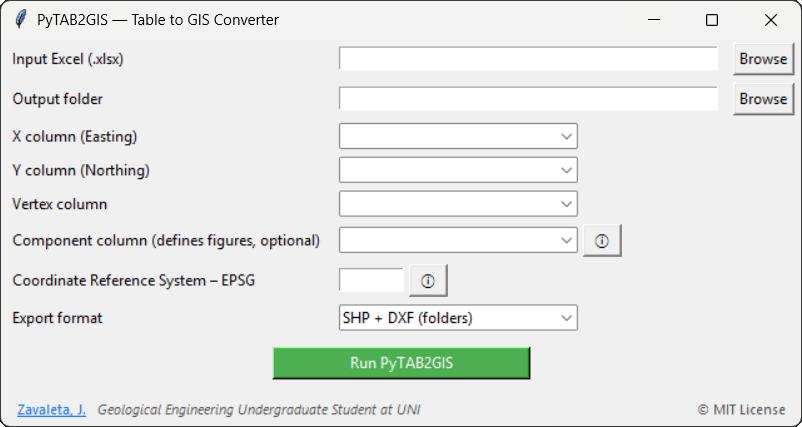

<a href="README.md">English</a> · <strong>Español</strong>

# PyTAB2GIS

**Convierte tablas de coordenadas en polígonos GIS con referencia espacial explícita.**

Transforma hojas Excel semiestructuradas de proyectos de minería, ambiente e
ingeniería en Shapefile, GeoPackage y, opcionalmente, DXF y paquetes ZIP.

> El programa no adivina el CRS. Introduce el EPSG u otra definición explícita y
> comprueba que la geometría resultante coincida con el documento fuente.

## Qué necesitas

Un libro XLSX con columnas para X/Este, Y/Norte, orden de vértices y,
opcionalmente, nombre de componente o figura. Se admiten varias hojas,
normalización de celdas vacías o combinadas y agrupación de componentes.

| COMPONENT | VERTEX | EASTING | NORTHING |
| --- | ---: | ---: | ---: |
| Stockpile A | 1 | 356120.4 | 8665032.8 |
| Stockpile A | 2 | 356181.2 | 8665040.1 |
| Stockpile A | 3 | 356176.9 | 8664979.5 |

La tabla original y el operador determinan unidades y CRS. Un polígono
geométricamente válido puede estar mal ubicado si la referencia es incorrecta.

## Instalación

Requiere Python 3.9 o superior. Conda/Miniforge es recomendable para las
dependencias nativas de GDAL, Fiona y GeoPandas; el flujo con pip es:

~~~powershell
git clone https://github.com/jordan-zav/PyTAB2GIS.git
cd PyTAB2GIS
python -m pip install -r requirements.txt
python -m pip install -e .
python -m pytab2gis.gui.main_gui
~~~

Usa un entorno aislado. Tesseract solo se necesita para funciones experimentales
de imagen/OCR, no para convertir Excel.

## Conversión paso a paso

1. Selecciona el libro y la carpeta de salida.
2. Asigna las columnas de X, Y, vértice y componente.
3. Introduce el EPSG de origen.
4. Elige SHP o GeoPackage y las opciones DXF/ZIP.
5. Revisa las salidas en QGIS antes de entregarlas.

La creación de polígonos comprueba cierre y validez básica. DXF depende de que
el GDAL instalado incluya ese controlador. Los ZIP opcionales reúnen los
archivos auxiliares de cada Shapefile.

## Comprobaciones de entrega

- Mantén juntos SHP, SHX, DBF, PRJ y archivos auxiliares.
- Abre GeoPackage y comprueba CRS, extensión y capa.
- Verifica unidades y posición de DXF en el programa CAD receptor.
- Reabre cada ZIP y comprueba sus archivos.
- Revisa orden de vértices, autointersecciones, áreas mínimas y geometrías multipartes.

## Estado y documentación

Es un prototipo público con release 1.0.0; el metadato del paquete conserva
0.0.0 provisional. El flujo documentado es la GUI para Excel. La CLI y la suite
de regresión necesitan consolidarse antes de otra release estable.

El paquete pytab2gis separa io, table, figures, geometry, crs, export y gui.
docs contiene arquitectura, captura y esquema de artículo; tests conserva
libros e imágenes de ejemplo. La captura es histórica: para la licencia vigente
consulta el archivo de licencia, no su texto en pantalla.

## Licencia y contacto

[GNU GPL v3](LICENSE.txt). Consultas de licencia comercial:
[jordanzav@gisgeo.dev](mailto:jordanzav@gisgeo.dev).
Jordan Zavaleta — [GisGeo Dev](https://gisgeo.dev).
